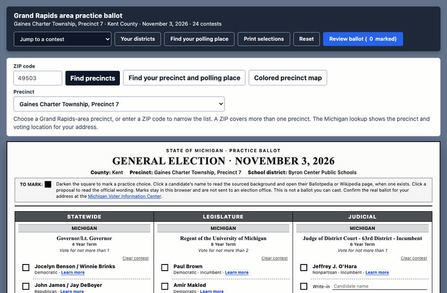

# Kent elections practice ballot

A one-page practice ballot for November 3, 2026. It covers the Grand Rapids area in Kent County and Inkster City Ward 1 Precinct 1 in Wayne County (ZIP 48141). Pick a precinct, see only the contests that precinct shares, and turn millage questions into dollars on a taxable value.

This is a reference guide. It is not a ballot you can cast. Confirm the official ballot for an address at the [Michigan Voter Information Center](https://mvic.sos.state.mi.us/).

**Live:** [https://ballot.360web.cloud](https://ballot.360web.cloud)



## Run it

The page is a static file. It fetches `data/ballot.json` and `data/precincts.json`, and falls back to copies embedded in `index.html` when those files are not served.

```bash
python3 -m http.server 8766
```

Open [http://127.0.0.1:8766/](http://127.0.0.1:8766/).

## What is in the data

- `data/ballot.json` — contests from the Kent County official candidate and proposal list, plus Inkster / Wayne County contests for Ward 1 Precinct 1. Each contest has a `scope` such as `statewide`, `congress-3`, `congress-12`, or `school-romulus`.
- `data/precincts.json` — Grand Rapids-area precincts plus Inkster City Ward 1 Precinct 1 (`48141`). A precinct is a list of scopes, not a second copy of the ballot.
- `scripts/build_guide.py` — replaces thin candidate notes with short sourced biographies and writes `data/ballot.json`.
- `scripts/add_inkster.py` — adds or refreshes the Inkster precinct and Wayne County contests, then embeds both JSON files in `index.html`.

Marks stay in this browser under `gr-practice-ballot:<precinct id>`. Nothing is submitted.

## Production

`docker-compose.prod.yml` builds an nginx image and joins the `360ws-network` on the VPS. Nginx Proxy Manager serves it at `ballot.360web.cloud`.

```bash
docker compose -f docker-compose.prod.yml up -d --build
```
